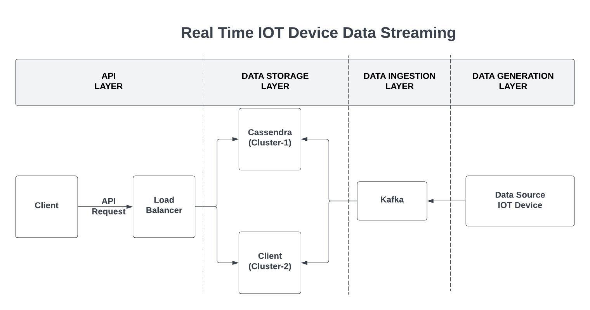

# Real-Time IoT Data Streaming

A streaming pipeline that ingests simulated Apple Watch telemetry through **Apache Kafka**, stores it in **Apache Cassandra**, serves it over a **Flask REST API** and visualises it in a live **Dash** dashboard.

Built as the course project for CSE 512 (Distributed Database Systems) at Arizona State University. The full write-up is in [`final_project_report.pdf`](final_project_report.pdf).



## How it works

1. **Produce**: `apple_stream.py` generates realistic device events with Faker and publishes them to a Kafka topic.
2. **Stream**: Kafka buffers the events and decouples producers from storage.
3. **Consume & store**: a Kafka consumer group reads the topic and writes each event to the matching Cassandra table.
4. **Serve**: `iot_apple.py` exposes the data through REST endpoints.
5. **Visualise**: `dashboard.py` polls the API and refreshes health, activity and environment charts every minute.

`data-stream-id.py` is a bulk loader that generates per-device health, activity and weather data for the dashboard demo.

### Data model

Six Cassandra tables cover the main kinds of device data:

| Table | Examples |
| --- | --- |
| `device_metadata` | model, OS version, battery level |
| `health_metrics` | heart rate, stress level |
| `activity_tracking` | steps, distance, calories |
| `environmental_data` | temperature, humidity, location |
| `notifications` | reminders, alerts, messages |
| `device_status_logs` | operational status, errors, battery health |

### API

| Endpoint | Returns |
| --- | --- |
| `GET /device_metadata`, `/health_metrics`, `/activity_tracking`, `/environmental_data`, `/notifications`, `/device_status_logs` | Records from each table |
| `GET /heart_rate`, `/stress_levels`, `/weather` | Aggregated series for the dashboard |
| `GET /device_ids`, `/states`, `/dates` | Filter values |

## Tech stack

Python 3.10 · Apache Kafka · Apache Cassandra · Flask · Dash / Plotly · Docker Compose

## Running locally

Requirements: Python 3.10 and Docker.

```bash
git clone https://github.com/saurin1004/real-time-iot-data-streaming.git
cd real-time-iot-data-streaming

python -m venv .venv && source .venv/bin/activate
pip install -r requirements.txt

docker compose up -d                 # Cassandra, Kafka and ZooKeeper
python cassandra_kafka_setup.py      # create the keyspace, tables and Kafka topic
python apple_stream.py --table health_metrics --num_records 100   # stream events through Kafka into Cassandra
python data-stream-id.py             # load per-device demo data for the dashboard
flask --app iot_apple run            # API on http://127.0.0.1:5000
python dashboard.py                  # dashboard
```

`purgedata.py` clears the tables between runs.

## Scaling notes

The local Docker setup runs a single Cassandra node (replication factor 1) and a single Kafka broker, to keep development lightweight. The design scales horizontally:
- **Kafka:** add brokers and partitions.
- **Cassandra:** add nodes and raise the replication factor for fault tolerance.
- **API:** run multiple instances behind a load balancer, as shown in the diagram.

## Project structure

| File | Purpose |
| --- | --- |
| `docker-compose.yaml` | Cassandra, Kafka and ZooKeeper services |
| `cassandra_kafka_setup.py` | Creates the keyspace, tables and Kafka topic |
| `apple_stream.py` | Kafka producer and consumer that stream simulated events into Cassandra (`--table`, `--num_records`) |
| `data-stream-id.py` | Bulk loader for per-device demo data |
| `iot_apple.py` | Flask REST API |
| `dashboard.py` | Real-time Dash dashboard |
| `purgedata.py` | Clears stored data |
| `*.csv` | Sample exported data |
| `final_project_report.pdf` | Project report |
| `video2224551998.mp4` | Demo recording |

## Troubleshooting

- **Docker:** make sure ports `9042` (Cassandra) and `9092` (Kafka) are free.
- **Cassandra:** it can take 30–60 seconds to accept connections after `docker compose up`. Re-run the setup script if it fails the first time.
- **Kafka:** check that ZooKeeper is running with `docker compose ps`.
